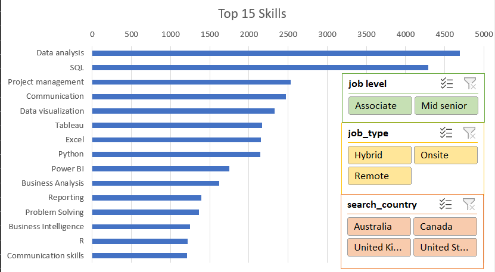
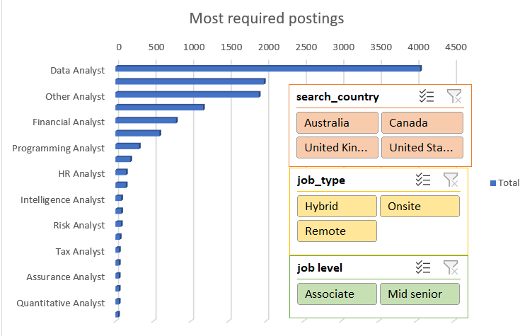
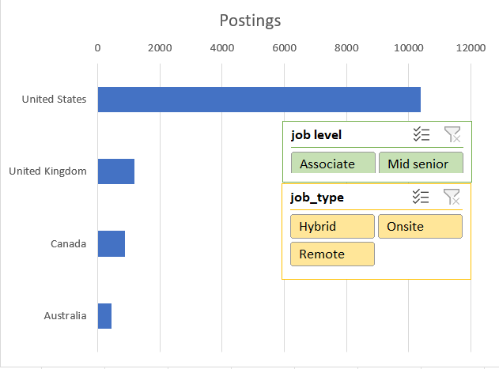
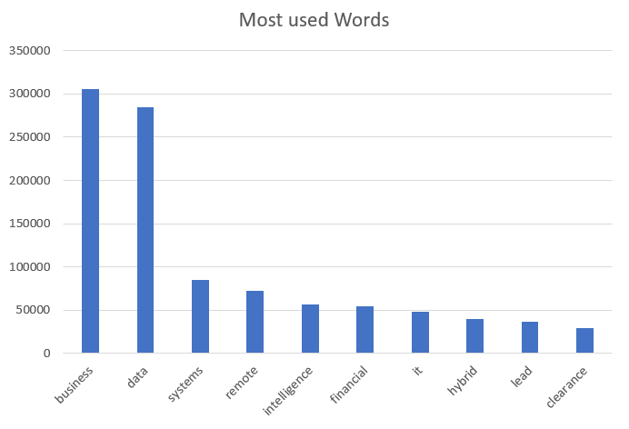

# Excel Job Market Analysis

> **Attribution Notice**
>
> This repository is a fork of the original project by [Mohith-akash](https://github.com/Mohith-akash/Excel-Data-Analyst-Portfolio-Project).
>
> The original Excel workbook, dataset, dashboards, Power Query transformations, Data Model, DAX measures and analytical work belong to the original creator.
>
> **Repository Maintainer:** Mohammed Haji Mudabbir
>
> See [ATTRIBUTION.md](ATTRIBUTION.md) and [LICENSE](LICENSE).

---

## Project Overview

An interactive Microsoft Excel analysis of **12,894 analyst job postings**, using Power Query, Power Pivot and DAX.

The original analysis transforms approximately 60 MB of raw job-posting data into an interactive dashboard containing job-market insights, skill-demand analysis and geographical comparisons.

**Data scope:** 12,894 job postings, approximately 80.5% from the United States.

## Dashboard Preview









---

## Key Findings

- **Total Job Postings:** 12,894 unique postings.
- **Skill Mentions:** 228,745 individual skill mentions.
- **Top Skills:** Data Analysis, SQL and Project Management.
- **Distinct Job Titles:** 6,797 standardized into approximately 20 roles.
- **Top Job Roles:** Data Analyst (4,058), Business Analyst (1,978) and System Analyst (1,167).
- **Geographical Distribution:** 10,386 postings from the United States.
- **Keyword Analysis:** More than 3.1 million words processed.

---

## Technical Overview

### 1. Power Query — Data Transformation

- More than 70 sequential transformation steps.
- Conditional columns with 35+ rules.
- Standardization of 6,797 distinct job titles.
- Splitting and unpivoting job-skill data.
- Transformation into 228,745 skill records.

### 2. Power Pivot — Data Modeling

- Excel Data Model containing 228,745 rows.
- Data modeling designed to support analysis across multiple tables.
- DAX measures for accurate aggregation.

### 3. DAX — Analytical Measures

The original workbook includes the following measure:

```dax
Total Unique Postings =
DISTINCTCOUNT('postings 2'[job_link])
```

This measure returns 12,894 unique job postings.

### 4. Excel Dashboard — Data Visualization

- Four PivotCharts.
- Three interactive slicers.
- Shared Report Connections.
- Job-level, job-type and country filtering.

---

## Repository Structure

```text
Excel-Data-Analyst-Portfolio-Project/
│
├── Job_Market_Analysis.xlsx
├── raw_postings.csv
├── dashboard_1.png
├── dashboard_2.png
├── dashboard_3.png
├── dashboard_4.png
├── analysis.py
├── requirements.txt
├── .gitattributes
├── .gitignore
├── LICENSE
├── ATTRIBUTION.md
└── README.md
```

---

## How to Open the Excel Workbook

**Recommended environment:** Microsoft Excel Desktop for Windows.

1. Clone or download the repository.
2. Ensure Git LFS is installed to retrieve the actual Excel workbook and CSV.
3. Open `Job_Market_Analysis.xlsx` using Microsoft Excel Desktop.
4. Enable the required workbook features.
5. Access the interactive dashboard and its slicers.

**Requirements:**
- Microsoft Excel Desktop.
- Power Query support.
- Power Pivot and Data Model support.

Note: Power Pivot and DAX functionality may not be available in every Excel edition.

---

## Python Companion Script

The original repository also includes `analysis.py`, a Python companion script that checks the top-skill findings using pandas.

Install dependencies:

```bash
pip install -r requirements.txt
```

Execute:

```bash
python analysis.py
```

The primary analytical implementation remains in the original Excel workbook.

---

## Project Credits & Repository Maintenance

This repository is maintained by **Mohammed Haji Mudabbir**.

The original project and Excel analytical implementation were created by **Mohith-akash**.

- **Original Repository:** [Excel Data Analyst Portfolio Project](https://github.com/Mohith-akash/Excel-Data-Analyst-Portfolio-Project)
- **Original Creator:** Mohith-akash
- **Repository Maintainer:** Mohammed Haji Mudabbir
- **License:** MIT

For complete attribution and contribution details, see [ATTRIBUTION.md](ATTRIBUTION.md).

This repository preserves the original creator's analytical work and licensing notices. Repository documentation and maintenance contributions are separately attributable to the maintainer.

See [ATTRIBUTION.md](ATTRIBUTION.md) for further details.

---

## License

This project retains the original **MIT License**.

Copyright (c) 2025 Mohith-akash.

See the root [LICENSE](LICENSE) file for complete terms.